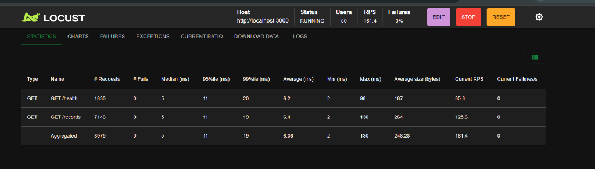
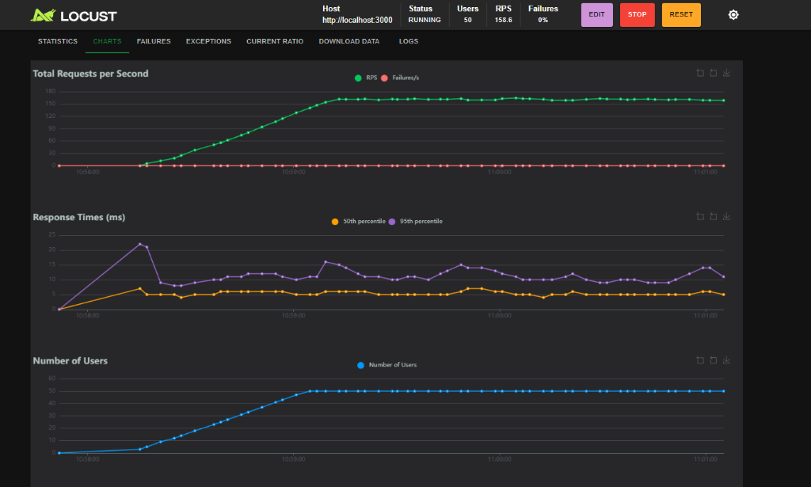
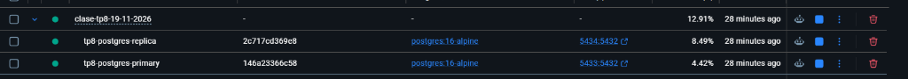

# Trabajo Práctico N.º 10 — Monitoreo, Pruebas de Carga y Evaluación de Desempeño

## 1. Carátula e Identificación

- **Trabajo Práctico**: N.º 10 — Monitoreo, Pruebas de Carga y Evaluación de Desempeño
- **Estudiante**: Gabriela Tamara Sosa
- **Asignatura**: Desarrollo de Aplicaciones para Ambientes Distribuidos
- **Sistema Bajo Prueba (SUT)**: TP8 (`clase-tp8-19-11-2026/` — NestJS + TypeORM + PostgreSQL Primary/Replica)
- **Herramienta de Carga**: Locust (`2.47.0`, Python `3.14.4`)

---

## 2. Objetivo General

Evaluar el desempeño, la estabilidad y los cuellos de botella de una aplicación distribuida real (**TP8**: backend NestJS en modo producción conectado a un clúster PostgreSQL Primary/Replica en Docker) sometiéndola a escenarios de **carga normal** (`50` usuarios concurrentes) y **estrés progresivo** (`250` usuarios concurrentes), correlacionando métricas de latencia, percentiles, *throughput*, tasa de errores y consumo de CPU/RAM.

---

## 3. Arquitectura del Sistema Evaluado y Selección de Endpoints

- **Backend**: NestJS (`node dist/main`, modo producción, puerto `3000`).
- **Base de datos**: PostgreSQL 16 en Docker (`tp8-postgres-primary` en `5433`, `tp8-postgres-replica` en `5434`) con replicación *streaming* (`wal_level=replica`, `hot_standby=on`).
- **Endpoints evaluados en [locustfile.py](./locustfile.py)**:
  - `GET /records` *(peso 8)*: Endpoint principal de lectura idempotente; consulta directamente `tp8-postgres-replica` sin generar datos residuales.
  - `GET /health` *(peso 2)*: Consulta `SELECT pg_is_in_recovery()` en paralelo sobre `primary` y `replica`.

---

## 4. Guía de ejecución de las pruebas

### 4.1. Requisitos previos e inicialización del entorno

- **Docker Desktop** en ejecución (para `tp8-postgres-primary` y `tp8-postgres-replica`).
- **Node.js** (`v24+`) y **pnpm** (con `clase-tp8-19-11-2026/backend/dist/` compilado).
- **Python** (`3.14+`) con el entorno virtual ya creado en `clase-tp10-19-11-2026/.venv` (si se recrea desde cero: `py -m venv clase-tp10-19-11-2026/.venv` y `pip install -r clase-tp10-19-11-2026/requirements.txt`).

Para ejecutar las pruebas de forma ordenada, utilizar **4 terminales PowerShell**:

1. **Terminal 1 — Levantar PostgreSQL Primary y Replica (TP8)** *(desde la raíz del repositorio)*:
   ```powershell
   docker compose -f clase-tp8-19-11-2026/docker-compose.yml up -d
   docker ps --format "table {{.Names}}\t{{.Status}}\t{{.Ports}}"
   ```
   Verificar que ambos contenedores figuren `healthy`.

2. **Terminal 2 — Iniciar el Backend NestJS en modo producción** *(desde `clase-tp8-19-11-2026/backend`)*:
   ```powershell
   cd clase-tp8-19-11-2026/backend
   pnpm run start:prod
   ```
   Confirmar que imprima `Backend TP8 escuchando en http://localhost:3000`.

3. **Activar el entorno virtual Python (opcional si se invoca `.venv/Scripts/python.exe` directamente)** *(desde la raíz del repositorio)*:
   ```powershell
   .\clase-tp10-19-11-2026\.venv\Scripts\Activate.ps1
   ```

---

### 4.2. Ejecución de Carga Normal (50 usuarios, 3 minutos)

Utiliza [locustfile.py](./locustfile.py) sin rampa automática (`TP8DistributedUser`). Ejecutar desde la **raíz del repositorio**:

- **Terminal 3 — Monitor de CPU y RAM** *(iniciar primero)*:
  ```powershell
  powershell -ExecutionPolicy Bypass -File clase-tp10-19-11-2026/monitor.ps1 -Label "carga-normal-final" -DurationSeconds 185 -IntervalSeconds 5
  ```
- **Terminal 4 — Locust (`50` usuarios, `3m`)**:
  ```powershell
  clase-tp10-19-11-2026/.venv/Scripts/python.exe -m locust -f clase-tp10-19-11-2026/locustfile.py --headless --host http://localhost:3000 -u 50 -r 10 -t 3m --csv clase-tp10-19-11-2026/resultados/carga-normal-final --html clase-tp10-19-11-2026/resultados/carga-normal-final.html
  ```

---

### 4.3. Ejecución de Estrés Progresivo (`50 → 100 → 150 → 200 → 250` usuarios, 180 s)

Utiliza [locustfile_stress.py](./locustfile_stress.py) con la clase `StagedStressShape(LoadTestShape)`, que arranca en `50` usuarios y escala cada `36 s` hasta `250` (`180 s` totales). No pasar `-u`, `-r` ni `-t` por CLI. Ejecutar desde la **raíz del repositorio**:

- **Terminal 3 — Monitor de CPU y RAM** *(iniciar primero)*:
  ```powershell
  powershell -ExecutionPolicy Bypass -File clase-tp10-19-11-2026/monitor.ps1 -Label "estres-final" -DurationSeconds 185 -IntervalSeconds 5
  ```
- **Terminal 4 — Locust (`LoadTestShape`)**:
  ```powershell
  clase-tp10-19-11-2026/.venv/Scripts/python.exe -m locust -f clase-tp10-19-11-2026/locustfile_stress.py --headless --host http://localhost:3000 --csv clase-tp10-19-11-2026/resultados/estres-final --html clase-tp10-19-11-2026/resultados/estres-final.html
  ```

---

### 4.4. Archivos generados e interpretación de métricas

Todos los artefactos se almacenan en `clase-tp10-19-11-2026/resultados/`:
- `<prefijo>_stats.csv`: resumen total por endpoint (conteo, fallos, latencias y RPS).
- `<prefijo>_stats_history.csv`: evolución segundo a segundo de usuarios, RPS y percentiles.
- `<prefijo>_failures.csv` y `<prefijo>_exceptions.csv`: detalle de errores HTTP y excepciones.
- `<prefijo>.html`: reporte visual interactivo (tablas y gráficos de RPS, latencia y usuarios).
- `monitor-<Label>.csv`: muestras de `node_cpu_s` (s acumulados), `node_ram_mb` (MB), `primary_cpu`/`replica_cpu` (`%`) y memoria de contenedores (`MiB`).

**Cómo interpretar las métricas clave:**
- **Promedio (`Average`)**: tiempo medio de respuesta; sensible a valores atípicos.
- **Máximo (`Max`)**: peor tiempo observado; útil para detectar picos puntuales de latencia o *garbage collection*.
- **P90 y P95**: el 90% y el 95% de las solicitudes respondieron por debajo de ese umbral (indicador principal de experiencia bajo carga).
- **RPS (`Throughput`)**: solicitudes completadas por segundo; cuando deja de crecer al subir usuarios o cae mientras sube P95, indica saturación.
- **Errores (`Failures`)**: porcentaje de respuestas HTTP 4xx/5xx o *timeouts*; un valor `> 0%` marca el inicio de degradación de disponibilidad.

---

### 4.5. Reproducción de capturas con la interfaz web de Locust

Para capturar pantallas en vivo sin modo `--headless`:
1. Con Docker (Terminal 1) y NestJS (Terminal 2) activos, iniciar Locust en modo web desde la **raíz del repositorio**:
   ```powershell
   clase-tp10-19-11-2026/.venv/Scripts/python.exe -m locust -f clase-tp10-19-11-2026/locustfile.py --host http://localhost:3000
   ```
2. Abrir `http://localhost:8089` en el navegador, ingresar cantidad de usuarios y *ramp-up*, y presionar **Start**.
3. Capturar la pestaña **STATISTICS** durante la ejecución, la pestaña **CHARTS** para los gráficos de RPS/P50/P95 y Docker Desktop (o `docker stats tp8-postgres-primary tp8-postgres-replica`) para el consumo de recursos.

---

### 4.6. Cómo detener los procesos correctamente

1. En **Terminal 4 (Locust)** y **Terminal 2 (NestJS)**: presionar `Ctrl + C`.
2. En **Terminal 1 (Docker Compose)**:
   ```powershell
   docker compose -f clase-tp8-19-11-2026/docker-compose.yml down
   ```

---

## 5. Escenarios de Prueba Ejecutados (Resultados Documentados)

1. **Prueba 1 — Carga Normal**:
   - `50` usuarios concurrentes, *ramp-up* `10 usuarios/s`, duración `2 minutos` (`--headless`).
   - Comando:
     ```powershell
     clase-tp10-19-11-2026/.venv/Scripts/locust.exe -f clase-tp10-19-11-2026/locustfile.py --headless --host http://localhost:3000 -u 50 -r 10 -t 2m --csv clase-tp10-19-11-2026/resultados/carga-normal --html clase-tp10-19-11-2026/resultados/carga-normal.html
     ```
2. **Prueba 2 — Estrés Progresivo**:
   - `250` usuarios concurrentes, *ramp-up* `25 usuarios/s`, duración `2 minutos` (`--headless`).
   - Comando:
     ```powershell
     clase-tp10-19-11-2026/.venv/Scripts/locust.exe -f clase-tp10-19-11-2026/locustfile.py --headless --host http://localhost:3000 -u 250 -r 25 -t 2m --csv clase-tp10-19-11-2026/resultados/estres --html clase-tp10-19-11-2026/resultados/estres.html
     ```
3. **Monitoreo de CPU y RAM**:
   - Ejecutado en paralelo con [monitor.ps1](./monitor.ps1) cada `5 segundos`, registrando `node.exe` (`Get-Process`) y los contenedores `tp8-postgres-primary` y `tp8-postgres-replica` (`docker stats --no-stream`).

---

## 6. Resultados Medidos

### 6.1. Comparativa de Latencia, Throughput y Errores

| Métrica | Carga Normal (50 usuarios, 2m) | Estrés Progresivo (250 usuarios, 2m) | Variación |
| :--- | :---: | :---: | :---: |
| **Total de solicitudes** | `18,851` (`15,006` `/records`, `3,845` `/health`) | `75,434` (`60,530` `/records`, `14,904` `/health`) | `4.00x` |
| **Errores HTTP / Timeouts** | `0 (0.00%)` | `0 (0.00%)` | Sin fallos |
| **Throughput agregado** | `158.66 req/s` | `634.38 req/s` | `4.00x` |
| **Latencia Promedio** | `6.76 ms` | `45.13 ms` | `6.68x` |
| **Latencia Mínima** | `1.83 ms` | `1.38 ms` | — |
| **Latencia Mediana (P50)** | `5 ms` | `24 ms` | `4.80x` |
| **Percentil P90** | `10 ms` | `120 ms` | `12.00x` |
| **Percentil P95** | `13 ms` | `150 ms` | `11.54x` |
| **Latencia Máxima** | `288.10 ms` | `495.06 ms` | `1.72x` |

### 6.2. Monitoreo de CPU y RAM

| Recurso | Carga Normal (50 usuarios) | Estrés Progresivo (250 usuarios) |
| :--- | :--- | :--- |
| **Backend NestJS (`node.exe`) RAM** | `85.41 MB` → `201.04 MB` | `84.82 MB` → `208.57 MB` |
| **Backend NestJS (`node.exe`) CPU acum.** | `2.69 s` → `26.08 s` (`+23.39 s`) | `2.66 s` → `53.98 s` (`+51.32 s`) |
| **`tp8-postgres-replica` CPU** | `0.00%` → pico `19.70%` (típico `4%–11%`) | `0.00%` → sostenido `14.72%–22.75%` |
| **`tp8-postgres-replica` RAM** | `31.8 MiB` → `48.06 MiB` | `31.76 MiB` → `48.68 MiB` |
| **`tp8-postgres-primary` CPU** | `0.00%` → pico `13.30%` (típico `0.5%–7.8%`) | `0.00%` → pico `7.24%` (típico `2%–3.4%`) |
| **`tp8-postgres-primary` RAM** | `28.9 MiB` → `35.03 MiB` | `28.11 MiB` → `43.88 MiB` |

---

## 7. Identificación del Primer Cuello de Botella

1. **Contención en el pool de conexiones hacia `postgres-replica`**:
   En `clase-tp8-19-11-2026/backend/src/database/database.module.ts`, TypeORM/pg utiliza el tamaño de pool por defecto (`max = 10` conexiones). Al escalar de `50` a `250` usuarios concurrentes, las peticiones de `GET /records` deben encolarse esperando una conexión libre, lo que explica que el percentil **P95** pase de `13 ms` a `150 ms` (`11.5x`) aun sin errores de timeout (`connectionTimeoutMillis: 3000`).
2. **Carga asimétrica verificada en PostgreSQL**:
   `tp8-postgres-replica` absorbe casi todo el tráfico de lectura (`14.7%–22.75%` de CPU sostenido en estrés), mientras `tp8-postgres-primary` permanece liviano (`2%–7%`), confirmando el funcionamiento del enrutamiento Read/Write del TP8.
3. **Saturación de CPU en host local**:
   Bajo `250` usuarios (`634 req/s`), el proceso único de Node.js duplicó su tiempo de CPU (`+51.32 s` en 2 minutos) y Locust reportó `CPU usage was too high` al compartir la misma máquina entre el generador de carga, NestJS y Docker.

---

## 8. Archivos y Reportes Generados

- Script Locust (carga normal): [locustfile.py](./locustfile.py)
- Script Locust (estrés progresivo `LoadTestShape`): [locustfile_stress.py](./locustfile_stress.py)
- Script de monitoreo: [monitor.ps1](./monitor.ps1)
- Reporte HTML Carga Normal: [resultados/carga-normal.html](./resultados/carga-normal.html)
- Reporte HTML Estrés: [resultados/estres.html](./resultados/estres.html)
- Métricas CSV:
  - [resultados/carga-normal_stats.csv](./resultados/carga-normal_stats.csv)
  - [resultados/estres_stats.csv](./resultados/estres_stats.csv)
  - [resultados/monitor-carga-normal.csv](./resultados/monitor-carga-normal.csv)
  - [resultados/monitor-estres.csv](./resultados/monitor-estres.csv)

---

## 9. Evidencias Visuales

1. **Locust en ejecución (50 usuarios concurrentes, 0% fallos)**:
   

2. **Dashboard de resultados y gráficos (RPS, P50/P95 y usuarios)**:
   

3. **Monitor de recursos en Docker Desktop (`tp8-postgres-replica` vs `tp8-postgres-primary`)**:
   

---

## 10. Conclusiones y Recomendaciones de Mejora

- El sistema TP8 soportó hasta `250` usuarios concurrentes (`634.38 req/s`) con **`0.00%` de errores**, manteniendo tiempos excelentes en carga normal (`P95 = 13 ms`) y degradación controlada en estrés (`P95 = 150 ms`).
- **Mejoras técnicas sugeridas** para escalar más allá de `250` usuarios:
  1. Aumentar explícitamente el tamaño del pool `pg` (`extra: { max: 30 }`) en `database.module.ts`.
  2. Incorporar caché en memoria o Redis para `GET /records` cuando la tabla tiene baja frecuencia de escritura.
  3. Ejecutar Locust desde una máquina separada del SUT para evitar contención de CPU en el generador de carga.
