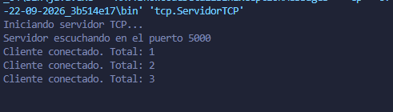
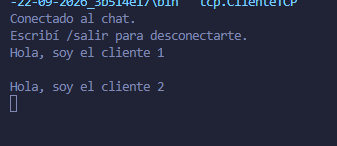
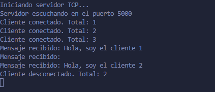
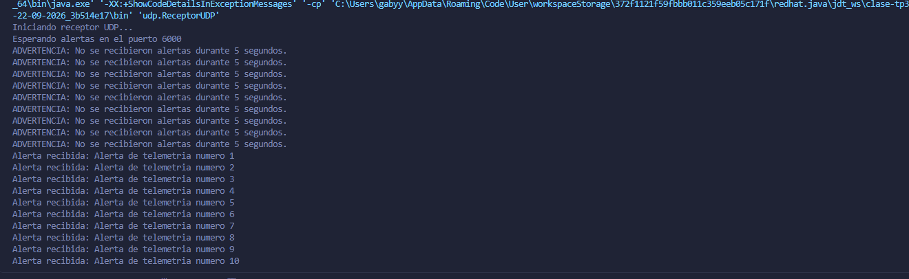
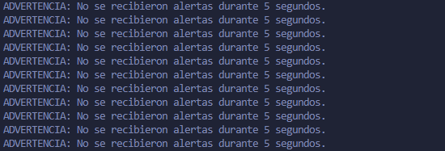

# TP N.º 3 — Comunicación mediante Sockets TCP/UDP

**Alumna:** Gabriela Tamara Sosa

## Descripción

Este proyecto implementa aplicaciones de comunicación entre procesos en Java utilizando sockets y la API `java.net`.

El trabajo práctico se divide en dos ejercicios:

- **Ejercicio 1: Chat TCP multihilo.** Implementa un servidor que acepta múltiples clientes simultáneamente y distribuye los mensajes enviados a los demás clientes conectados.
- **Ejercicio 2: Emisor y receptor UDP.** Implementa un sistema de envío de alertas periódicas mediante datagramas UDP. El receptor controla el tiempo de espera y muestra una advertencia cuando no recibe mensajes durante cinco segundos.

## Tecnologías utilizadas

- Java 8
- API `java.net`
- API `java.io`
- Sockets TCP
- Datagramas UDP
- Hilos (`Thread`)
- Visual Studio Code

## Estructura del proyecto

```text
clase-tp3-22-09-2026/
├── src/
│   ├── tcp/
│   │   ├── ServidorTCP.java
│   │   ├── ManejadorCliente.java
│   │   └── ClienteTCP.java
│   └── udp/
│       ├── ReceptorUDP.java
│       └── EmisorUDP.java
├── evidencias/
│   ├── tcp-desconexion.png
│   ├── tcp-difusion-mensajes.png
│   ├── tcp-servidor-tres-clientes.png
│   ├── udp-recepcion-alertas.png
│   └── udp-timeout.png
└── README.md
```

## Ejercicio 1: Chat TCP multihilo

### Funcionamiento

El servidor escucha conexiones entrantes en el puerto `5000`. Cuando un cliente se conecta, el servidor crea un hilo independiente para atender su comunicación.

Los clientes pueden enviar mensajes al servidor. Cada mensaje recibido se retransmite a los demás clientes conectados, excluyendo al emisor.

Cuando un cliente escribe `/salir`, se cierra su conexión y el servidor lo elimina del registro de clientes, sin detener el servicio para los demás.

### Archivos utilizados

- **`ServidorTCP.java`:** acepta conexiones entrantes, registra los clientes conectados y coordina la distribución de los mensajes.
- **`ManejadorCliente.java`:** gestiona la comunicación con cada cliente en un hilo independiente. Se encarga de recibir sus mensajes y gestionar su desconexión.
- **`ClienteTCP.java`:** permite conectarse al servidor, enviar mensajes, recibir mensajes de otros clientes y desconectarse.

### Parámetros de conexión

| Parámetro | Valor |
|---|---|
| Protocolo | TCP |
| Dirección del servidor | `localhost` |
| Puerto | `5000` |
| Clientes de prueba | 3 |

### Ejemplo de funcionamiento

El servidor acepta tres clientes simultáneamente:

```text
Servidor escuchando en el puerto 5000
Cliente conectado. Total: 1
Cliente conectado. Total: 2
Cliente conectado. Total: 3
```

Un cliente envía el siguiente mensaje:

```text
Hola, soy el cliente 1
```

Los demás clientes reciben el mensaje, mientras que el emisor no recibe su propio mensaje retransmitido.

### Desconexión de un cliente

Para desconectarse, el cliente escribe:

```text
/salir
```

El servidor elimina al cliente del registro y actualiza la cantidad de conexiones activas:

```text
Cliente desconectado. Total: 2
```

El servidor continúa funcionando y permite que los demás clientes sigan comunicándose.

## Ejercicio 2: Emisor y receptor UDP

### Funcionamiento

El emisor genera alertas periódicas y las envía al receptor mediante datagramas UDP.

El receptor escucha en el puerto `6000`, recibe los datagramas y muestra su contenido. Se configura un timeout de `5000` milisegundos para limitar a cinco segundos la espera de cada operación de recepción.

Si no se recibe ningún datagrama durante ese período, se captura la excepción `SocketTimeoutException`, se muestra una advertencia y el receptor continúa escuchando.

### Archivos utilizados

- **`EmisorUDP.java`:** genera y envía alertas periódicas mediante datagramas UDP.
- **`ReceptorUDP.java`:** recibe las alertas, muestra su contenido y controla el timeout de recepción.

### Parámetros de comunicación

| Parámetro | Valor |
|---|---|
| Protocolo | UDP |
| Dirección de destino | `localhost` |
| Puerto del receptor | `6000` |
| Intervalo de envío | 3 segundos |
| Timeout de recepción | 5 segundos |

### Ejemplo de recepción

```text
Iniciando receptor UDP...
Esperando alertas en el puerto 6000
Alerta recibida: Alerta de telemetria numero 1
Alerta recibida: Alerta de telemetria numero 2
Alerta recibida: Alerta de telemetria numero 3
```

### Prueba del timeout

Al detener el emisor y dejar activo el receptor, después de cinco segundos sin recibir datagramas aparece una advertencia:

```text
ADVERTENCIA: No se recibieron alertas durante 5 segundos.
```

El receptor continúa escuchando nuevos datagramas sin necesidad de reiniciarse.

## Ejecución del proyecto

Los programas se ejecutaron desde Visual Studio Code utilizando la opción **Run Java**.

### Ejercicio 1: Comunicación TCP

1. Ejecutar `ServidorTCP.java`.
2. Ejecutar `ClienteTCP.java` en tres instancias independientes para simular varios clientes conectados.
3. Verificar que el servidor acepte las conexiones de los clientes.
4. Enviar mensajes desde distintos clientes y comprobar que los demás los reciban, sin que el emisor reciba su propio mensaje retransmitido.
5. Escribir `/salir` en uno de los clientes y comprobar que se desconecte sin interrumpir el funcionamiento del servidor.

**Nota:** `ManejadorCliente.java` no se ejecuta manualmente. El servidor utiliza esta clase para gestionar la comunicación de cada cliente en un hilo independiente.

### Ejercicio 2: Comunicación UDP

1. Ejecutar `ReceptorUDP.java`.
2. Ejecutar `EmisorUDP.java`.
3. Verificar que el receptor muestre las alertas recibidas.
4. Detener el emisor y comprobar que, después de cinco segundos sin recibir datagramas, el receptor muestre una advertencia.
5. Verificar que el receptor continúe escuchando después de mostrar la advertencia.

## Pruebas realizadas

| Prueba | Resultado esperado |
|---|---|
| Conexión de tres clientes TCP | El servidor acepta las tres conexiones. |
| Difusión de mensajes TCP | Los clientes conectados reciben los mensajes de los demás. |
| Desconexión TCP | El cliente se desconecta y el servidor continúa funcionando. |
| Recepción de alertas UDP | El receptor muestra los datagramas recibidos. |
| Timeout UDP | Se muestra una advertencia tras cinco segundos sin recepción y el receptor continúa escuchando. |

Las pruebas se realizaron desde Visual Studio Code y se registraron mediante capturas de pantalla incluidas en la carpeta `evidencias/`.

## Cuestionario teórico-práctico

### 1. Capa de Transporte: Explique las diferencias estructurales y operativas entre una comunicación orientada a conexión (TCP) y una sin conexión (UDP) en el contexto del paso de mensajes.

TCP es un protocolo orientado a conexión que establece una conexión antes de transmitir datos. Proporciona una comunicación fiable y ordenada mediante mecanismos de confirmación, secuenciación y retransmisión. Los datos se transmiten como un flujo de bytes.

UDP es un protocolo sin conexión que permite enviar datagramas sin establecer previamente una conexión. No garantiza la entrega ni el orden de los mensajes, pero tiene una menor sobrecarga y permite transmitir datos de manera más sencilla.

En este trabajo, TCP se utiliza para el chat multicliente, mientras que UDP se emplea para enviar alertas periódicas.

### 2. API java.net: ¿Cuál es la función del método ServerSocket.accept()?
Justifique por qué es indispensable usar un hilo dedicado por cada cliente aceptado en un servidor TCP.

El método ServerSocket.accept() espera de forma bloqueante una conexión entrante. Cuando un cliente se conecta, devuelve un objeto Socket que permite intercambiar datos con ese cliente.

Utilizar un hilo dedicado por cada cliente permite atender varias conexiones simultáneamente. Cada hilo gestiona la comunicación con su cliente sin bloquear la atención de los demás. De esta manera, el servidor puede continuar aceptando nuevas conexiones mientras los clientes ya conectados envían y reciben mensajes.

En este proyecto, ServidorTCP.java acepta las conexiones y utiliza ManejadorCliente.java para gestionar la comunicación de cada cliente en un hilo independiente.

### 3. Manejo de Errores y Resiliencia: ¿Qué sucede si el paquete UDP enviado por el emisor se pierde en la red? ¿Cómo lo detecta el receptor con setSoTimeout()?

UDP no garantiza la entrega de los datagramas ni realiza retransmisiones automáticas. Si un paquete se pierde en la red, el receptor no recibe ese datagrama.

El método setSoTimeout(5000) establece un tiempo máximo de espera de cinco segundos para una operación de recepción. Si durante ese período no llega ningún datagrama, se produce una excepción SocketTimeoutException.

En este proyecto, el receptor captura la excepción, muestra una advertencia y continúa escuchando nuevos mensajes. Sin embargo, el timeout no permite determinar si un paquete específico se perdió; únicamente indica que no se recibió ningún datagrama durante el intervalo establecido.

## Capturas de pantalla

### 1. Servidor TCP con tres clientes conectados



### 2. Difusión de mensajes entre clientes



### 3. Desconexión de un cliente



### 4. Recepción de alertas UDP



### 5. Timeout del receptor UDP



## Conclusión

Este trabajo permitió aplicar los conceptos de comunicación entre procesos mediante sockets TCP y UDP.

En el primer ejercicio se implementó un chat TCP multihilo que acepta múltiples clientes, distribuye mensajes y gestiona las desconexiones.

En el segundo ejercicio se desarrolló un emisor y receptor UDP para el intercambio de alertas periódicas, incorporando un timeout de cinco segundos para detectar períodos sin recepción.

Las pruebas realizadas permitieron comprobar la conexión simultánea de tres clientes TCP, la difusión de mensajes, la desconexión de clientes y la recepción de alertas UDP con sus correspondientes advertencias de timeout.