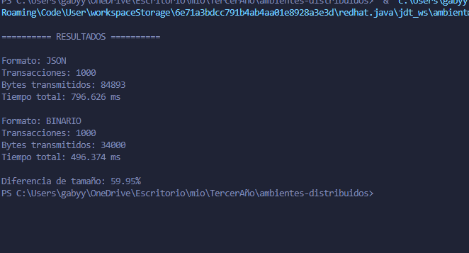
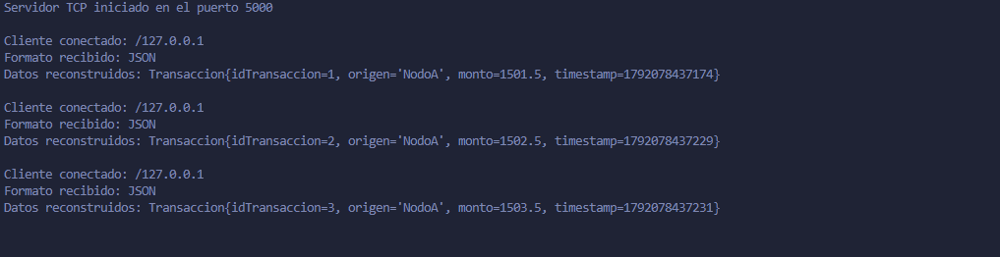
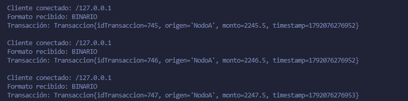

# TP4 — Representación de Datos y Paso de Mensajes

**Alumna:** Gabriela Tamara Sosa

## Objetivo

Implementar la serialización y deserialización de estructuras de datos en Java, utilizando JSON y representación binaria para transmitir transacciones mediante sockets TCP.

## Estructura del proyecto

```text
clase-tp4-22-09-2026/
├── src/
│   ├── ClienteTCP.java
│   ├── ParserMensajes.java
│   ├── ServidorTCP.java
│   └── Transaccion.java
├── evidencias/
│   ├── resultados-cliente.png
│   └── servidor-tcp.png
└── README.md
```

## Ejecución del proyecto

Los programas se ejecutaron desde Visual Studio Code utilizando la opción **Run Java**.

### Ejercicio 1: Serialización y paso de mensajes

1. Ejecutar `ServidorTCP.java` con **Run Java** y verificar que quede escuchando conexiones en el puerto `5000`.
2. Ejecutar `ClienteTCP.java` con **Run Java**. La prueba se inicia automáticamente, sin selector ni argumentos.
3. El cliente envía 1000 transacciones JSON y luego 1000 transacciones binarias. Al terminar muestra para cada formato los bytes transmitidos y el tiempo total, además de la diferencia porcentual de tamaño.
4. El servidor muestra el formato recibido y los datos de cada transacción reconstruida.

**Nota:** `Transaccion.java` y `ParserMensajes.java` no se ejecutan manualmente. El cliente y el servidor utilizan estas clases para representar las transacciones y realizar la serialización y deserialización de los mensajes.

## Implementación

El sistema está compuesto por las siguientes clases:

- `Transaccion.java`: representa una transacción con identificador, origen, monto y timestamp.
- `ParserMensajes.java`: convierte transacciones a JSON y bytes binarios, y reconstruye los objetos recibidos.
- `ServidorTCP.java`: recibe los mensajes mediante TCP, identifica su formato y deserializa las transacciones.
- `ClienteTCP.java`: ejecuta automáticamente la comparación completa de 1000 transacciones por formato.

## Resultados experimentales

Se ejecutaron dos pruebas, una con JSON y otra con representación binaria. Cada prueba transmitió 1000 transacciones.

| Métrica | JSON | Binario |
|---|---:|---:|
| Transacciones | 1000 | 1000 |
| Bytes transmitidos | 84.893 | 34.000 |
| Tiempo total | 796,626 ms | 496,374 ms |

La representación binaria redujo el tamaño transmitido en un 59,95 % respecto de JSON. En esta ejecución también registró un menor tiempo total.

Los resultados son experimentales y pueden variar según el entorno de ejecución. Los tiempos medidos incluyen la serialización, el envío por TCP, el establecimiento de conexiones y las confirmaciones del servidor.

## Conclusión

En esta prueba, la representación binaria resultó más compacta y rápida que JSON. JSON, por su parte, ofrece una representación legible que facilita la inspección de los mensajes. La elección del formato depende de las necesidades de interoperabilidad, legibilidad y eficiencia.

## Evidencias

### Resultados del cliente

Comparación del tamaño y tiempo de transmisión de 1000 transacciones en JSON y binario.



### Servidor TCP: recepción JSON

Recepción y reconstrucción de transacciones en formato JSON.



### Servidor TCP

Recepción y deserialización de transacciones en formato binario.


