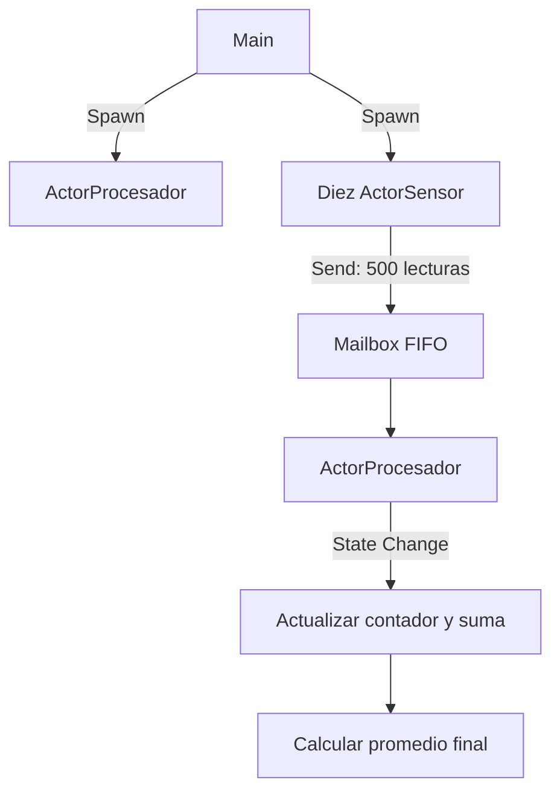

# TP5 — Concurrencia y Sincronización con el Modelo de Actores

**Alumna:** Gabriela Tamara Sosa

## Objetivo

Implementar un sistema concurrente en Java basado en el modelo de actores, utilizando mensajes asincrónicos, un buzón FIFO y aislamiento del estado interno del procesador.

## Estructura del proyecto

```text
clase-tp5-24-04-2026/
├── src/
│   ├── Lectura.java
│   ├── ActorProcesador.java
│   ├── ActorSensor.java
│   └── Main.java
├── evidencias/
│   └── ejecucion-tp5.png
└── README.md
```

## Ejecución del proyecto

El programa se ejecuta desde Visual Studio Code utilizando la opción **Run Java** sobre `Main.java`.

1. Ejecutar `Main.java`.
2. El programa crea un actor procesador y diez actores sensores.
3. Cada sensor genera y envía 50 lecturas de temperatura.
4. El procesador recibe los mensajes mediante un buzón FIFO y actualiza su contador y suma acumulada.
5. Al finalizar, muestra la cantidad de mensajes procesados y el promedio final.

**Nota:** `Lectura.java`, `ActorSensor.java` y `ActorProcesador.java` no se ejecutan manualmente. `Main.java` inicia el sistema y utiliza las demás clases.

## Implementación

- `Lectura.java`: representa un mensaje inmutable con el identificador del sensor y la temperatura.
- `ActorSensor.java`: genera 50 lecturas y las envía al procesador.
- `ActorProcesador.java`: procesa los mensajes secuencialmente y calcula el contador y el promedio.
- `Main.java`: inicia el procesador y crea los diez sensores.

## Las tres operaciones del modelo de actores

- **Spawn:** creación de los actores sensores y del procesador.
- **Send:** envío concurrente de 500 lecturas al procesador.
- **State Change:** actualización del estado privado del procesador al atender cada mensaje.

## Diagrama de flujo



## Resultados de ejecución

En la prueba realizada se procesaron 500 mensajes y se obtuvo un promedio final de 27,50 °C.

El promedio puede variar en otras ejecuciones porque las temperaturas se generan aleatoriamente.

## Restricciones de concurrencia

La implementación no utiliza explícitamente bloques `synchronized` ni `ReentrantLock`. El estado interno de `ActorProcesador` se mantiene privado y solo se modifica durante el procesamiento de los mensajes recibidos.

La comunicación entre los actores se realiza mediante mensajes asincrónicos. El buzón utiliza `LinkedBlockingQueue`, que gestiona internamente la coordinación necesaria para garantizar el acceso concurrente seguro a la cola y mantener el orden FIFO.
## Evidencias

### Ejecución del programa

Agregar una captura de Visual Studio Code donde se observe el procesamiento de los mensajes y el resultado final.


