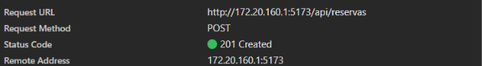
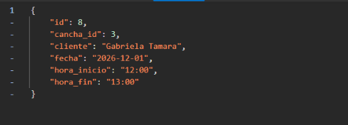
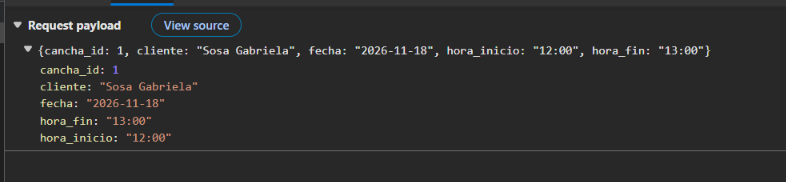
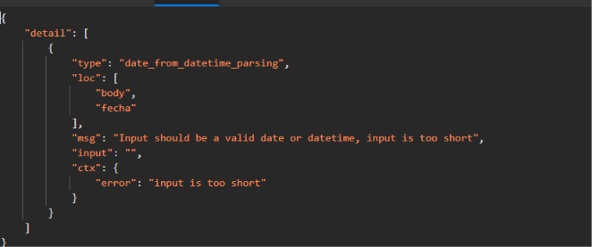
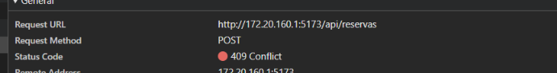
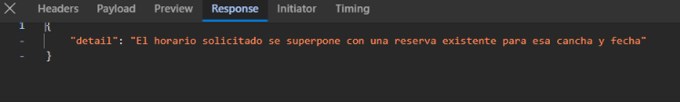
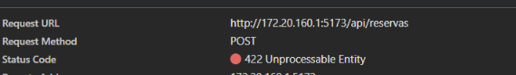

# TP7 — Integración entre Capas y Consumo de APIs / Servicios Distribuidos (ReservaCancha)

**Sistema:** ReservaCancha — Sistema de Gestión de Reservas de Canchas Deportivas  
**Materia:** Desarrollo de Aplicaciones para Ambientes Distribuidos  
**Alumna:** Gabriela Tamara Sosa  
**Lenguajes utilizados:** Python 3.12, TypeScript 5.7, HTML5, CSS3, SQL  
**Frameworks y bibliotecas principales:** FastAPI, Uvicorn, Pydantic v2, Vue 3 (Composition API), Vue Router 4, Vite 6, Tailwind CSS v4 (TailAdmin / Reka UI), Flatpickr  
**Persistencia e infraestructura:** SQLite 3, Docker y Docker Compose  

---

## 1. Descripción general

### Problema que resuelve y objetivo
**ReservaCancha** resuelve la gestión centralizada de turnos y disponibilidad de instalaciones deportivas (canchas de Fútbol 5, Pádel, etc.), evitando la superposición de horarios y validando las reglas de negocio en un servidor central accesible a través de la red.

El objetivo del trabajo práctico es diseñar e implementar una aplicación distribuida bajo el modelo **Cliente-Servidor**, integrando un frontend SPA independiente con un backend RESTful mediante el protocolo **HTTP/1.1** y el intercambio de datos estructurados en formato **JSON**.

### Funcionalidades implementadas
1. **Panel principal (`/`)**: verifica en tiempo real el estado de salud del servicio (`GET /salud`) y presenta métricas de canchas activas (`GET /canchas`) y reservas registradas (`GET /reservas`).
2. **Consulta de canchas (`/canchas`)**: lista todas las canchas deportivas activas con su identificador, nombre, deporte, precio por hora y acceso directo para reservar.
3. **Listado y búsqueda de reservas (`/reservas`)**: muestra las reservas registradas en una tabla paginada con filtro de búsqueda por cliente, cancha, fecha o ID.
4. **Detalle de reserva (`/reservas/:id`)**: consulta una reserva específica por su identificador (`GET /reservas/{id}`) junto con la información de la cancha asociada.
5. **Registro de nueva reserva (`/reservas/nueva`)**: formulario interactivo con selector de cancha, calendario visual en español (`dd/mm/aaaa` en interfaz, `YYYY-MM-DD` hacia la API), selector de hora de inicio en formato 24 horas (`HH:mm`), selector de duración (`1 hora`, `2 horas`, `3 horas`) con cálculo reactivo automático de `hora_fin`, y visualización detallada de respuestas exitosas (`HTTP 201`) o errores del backend (`HTTP 400`, `404`, `409`, `422` y errores de conexión).

### Responsabilidades por capa
- **Responsabilidad del Cliente (`cliente/`)**: proveer la interfaz gráfica de usuario, capturar las entradas del operador, calcular reactivamente la hora de finalización a partir de la duración elegida, serializar las peticiones a JSON, consumir la API REST mediante `fetch`, deserializar las respuestas recibidas y representar visualmente tanto los datos como los errores HTTP o de red.
- **Responsabilidad del Servidor (`servidor/`)**: exponer los endpoints REST, validar la estructura y tipos de los datos entrantes mediante esquemas Pydantic, aplicar las reglas de negocio (existencia y estado activo de la cancha, prohibición de fechas pasadas, validación `hora_inicio < hora_fin` y control de superposición horaria), gestionar la persistencia transaccional en SQLite y devolver códigos de estado HTTP semánticos con payloads JSON.

---

## 2. Arquitectura del sistema

El sistema está compuesto por dos aplicaciones **independientes y desacopladas** que se comunican exclusivamente por red mediante **HTTP/1.1**:

- **El cliente no accede directamente a la base de datos SQLite** ni comparte código o memoria con el backend.
- **El servidor está organizado en una arquitectura por capas**:
  1. **Capa de Presentación / Endpoints (`app/api/endpoints/`)**: define las rutas HTTP y códigos de estado en FastAPI.
  2. **Capa de Esquemas / DTOs (`app/schemas/`)**: valida y serializa/deserializa estructuras JSON con Pydantic v2.
  3. **Capa de Controladores (`app/controllers/`)**: coordina la conversión entre modelos de dominio y esquemas de respuesta.
  4. **Capa de Servicios (`app/services/`)**: implementa las reglas de negocio y lanza excepciones HTTP (`400`, `404`, `409`).
  5. **Capa de Repositorios (`app/repositories/`)**: encapsula las consultas SQL parametrizadas sobre SQLite.
  6. **Capa de Modelos y Base de Datos (`app/models/` y `app/db/`)**: define las entidades de dominio (`Cancha`, `Reserva`), la conexión a `data/reservas.db` y la inicialización de tablas y datos semilla.

### Diagrama de arquitectura

```mermaid
flowchart LR
    subgraph Cliente["Cliente Web Independiente (Vue 3 + TypeScript :5173)"]
        Vistas["Vistas Vue 3\n(Dashboard, Canchas,\nReservas, NuevaReserva,\nDetalleReserva)"]
        ServicioAPI["Cliente HTTP\n(src/services/api.ts)\nfetch + JSON.stringify / response.json()"]
        ViteProxy["Proxy HTTP Vite\n(/api -> :8000)"]
        Vistas --> ServicioAPI --> ViteProxy
    end

    subgraph Canal["Canal de Comunicación"]
        HTTP["HTTP/1.1\nContent-Type: application/json\nGET /salud | GET /canchas\nGET /reservas | GET /reservas/{id}\nPOST /reservas"]
    end

    subgraph Servidor["Servidor API REST (FastAPI + Python 3.12 :8000)"]
        Endpoints["Endpoints FastAPI\n(app/api/endpoints/)"]
        Schemas["Esquemas Pydantic v2\n(app/schemas/)"]
        Controllers["Controladores\n(app/controllers/)"]
        Services["Lógica de Negocio\n(app/services/)"]
        Repos["Repositorios SQL\n(app/repositories/)"]
        SQLite[("Base de Datos SQLite\n(servidor/data/reservas.db)")]

        Endpoints <--> Schemas
        Endpoints --> Controllers --> Services --> Repos --> SQLite
    end

    ViteProxy <-->|"Solicitud / Respuesta JSON"| HTTP <--> Endpoints
```



### Estructura del repositorio

```text
clase-tp7-05-10-2026/
├── servidor/
│   ├── app/
│   │   ├── api/
│   │   │   └── endpoints/
│   │   │       ├── canchas.py
│   │   │       └── reservas.py
│   │   ├── controllers/
│   │   │   ├── cancha_controller.py
│   │   │   └── reserva_controller.py
│   │   ├── db/
│   │   │   ├── connection.py
│   │   │   └── initialization.py
│   │   ├── models/
│   │   │   ├── cancha.py
│   │   │   └── reserva.py
│   │   ├── repositories/
│   │   │   ├── cancha_repository.py
│   │   │   └── reserva_repository.py
│   │   ├── schemas/
│   │   │   ├── cancha.py
│   │   │   └── reserva.py
│   │   ├── services/
│   │   │   ├── cancha_service.py
│   │   │   └── reserva_service.py
│   │   └── main.py
│   ├── data/
│   │   └── reservas.db          # Base SQLite local (excluida de Git mediante .gitignore)
│   ├── .dockerignore
│   ├── Dockerfile
│   └── requirements.txt
├── cliente/
│   ├── public/
│   │   └── images/
│   ├── src/
│   │   ├── assets/
│   │   │   └── main.css
│   │   ├── components/
│   │   │   ├── common/
│   │   │   ├── layout/
│   │   │   └── ui/
│   │   ├── composables/
│   │   ├── icons/
│   │   ├── router/
│   │   │   └── index.ts
│   │   ├── services/
│   │   │   └── api.ts
│   │   ├── types/
│   │   │   └── api.ts
│   │   ├── utils/
│   │   ├── views/
│   │   │   └── ReservaCancha/
│   │   │       ├── DashboardView.vue
│   │   │       ├── CanchasView.vue
│   │   │       ├── ReservasView.vue
│   │   │       ├── NuevaReservaView.vue
│   │   │       └── DetalleReservaView.vue
│   │   ├── App.vue
│   │   └── main.ts
│   ├── .dockerignore
│   ├── Dockerfile
│   ├── index.html
│   ├── package.json
│   └── vite.config.ts
├── evidencias/
│   ├── evidencia-202-created.png
│   ├── payload-created.png
│   ├── error-409-fecha-hora.png
│   ├── json-error-409-fecha-hora.png
│   ├── response-409-error.png
│   ├── error-422.png
│   └── error-fecha-422.png
├── docker-compose.yml
├── .gitignore
└── README.md
```

---

## 3. Tecnologías utilizadas

| Componente | Tecnología | Rol en el sistema |
|---|---|---|
| **Frontend** | Vue 3 (Composition API) + TypeScript 5.7 | Construcción de vistas reactivas y tipado estático de contratos de API |
| **Frontend (Enrutamiento y Build)** | Vue Router 4 + Vite 6 | Navegación SPA y servidor de desarrollo con proxy HTTP `/api` |
| **Frontend (UI y Calendario)** | Tailwind CSS v4 + TailAdmin (`reka-ui`) + Flatpickr | Componentes visuales (tarjetas, tablas, alertas, badges, campos) y selectores de fecha/hora en español |
| **Backend** | Python 3.12 + FastAPI + Uvicorn | Exposición de endpoints REST, documentación OpenAPI (`/docs`) y servidor ASGI |
| **Backend (Validación)** | Pydantic v2 | Validación de esquemas de entrada/salida y serialización JSON |
| **Base de datos** | SQLite 3 (`sqlite3`) | Persistencia relacional de las tablas `canchas` y `reservas` con integridad referencial (`PRAGMA foreign_keys = ON`) |
| **Protocolo de comunicación** | HTTP/1.1 | Transporte cliente-servidor mediante métodos `GET` y `POST` y códigos de estado estándar |
| **Formato de intercambio** | JSON (`application/json`) | Representación textual interoperable para solicitudes y respuestas |
| **Infraestructura** | Docker + Docker Compose | Contenerización y orquestación de los servicios `servidor` (`:8000`) y `cliente` (`:5173`) |

---

## 4. Contrato de la API REST (Endpoints implementados)

| Método | Ruta | Descripción | Código Éxito | Códigos de Error posibles |
|---|---|---|---|---|
| `GET` | `/` | Información general y estado de la API | `200 OK` | Error de red / no disponible |
| `GET` | `/salud` | Verificación de salud del servicio | `200 OK` | Error de red / no disponible |
| `GET` | `/canchas` | Lista todas las canchas deportivas activas | `200 OK` | Error de red / no disponible |
| `GET` | `/reservas` | Lista todas las reservas ordenadas por fecha y hora | `200 OK` | Error de red / no disponible |
| `GET` | `/reservas/{id}` | Obtiene el detalle de una reserva por su ID entero | `200 OK` | `404 Not Found`, `422 Unprocessable Entity` |
| `POST` | `/reservas` | Registra una nueva reserva validando disponibilidad y reglas de negocio | `201 Created` | `400 Bad Request`, `404 Not Found`, `409 Conflict`, `422 Unprocessable Entity` |

### Ejemplos reales de estructuras JSON

#### 1. `GET /canchas` — Respuesta (`HTTP 200 OK`)
```json
[
  {
    "id": 1,
    "nombre": "Cancha 1",
    "deporte": "Fútbol 5",
    "precio_hora": 25000.0,
    "activa": true
  },
  {
    "id": 2,
    "nombre": "Cancha 2",
    "deporte": "Fútbol 5",
    "precio_hora": 28000.0,
    "activa": true
  },
  {
    "id": 3,
    "nombre": "Cancha 3",
    "deporte": "Pádel",
    "precio_hora": 18000.0,
    "activa": true
  }
]
```

#### 2. `POST /reservas` — Cuerpo de solicitud (Request JSON)
```json
{
  "cancha_id": 1,
  "cliente": "Juan Pérez",
  "fecha": "2026-11-25",
  "hora_inicio": "18:00",
  "hora_fin": "20:00"
}
```

#### 3. `POST /reservas` — Respuesta exitosa (`HTTP 201 Created`)
```json
{
  "id": 5,
  "cancha_id": 1,
  "cliente": "Juan Pérez",
  "fecha": "2026-11-25",
  "hora_inicio": "18:00",
  "hora_fin": "20:00"
}
```

---

## 5. Serialización, Deserialización (Marshalling / Unmarshalling) y Manejo de Errores

### Proceso de Marshalling y Unmarshalling
1. **En el Cliente (`cliente/src/services/api.ts`)**:
   - **Serialización (Marshalling saliente):** La función `crearReserva(payload)` recibe un objeto TypeScript que cumple la interfaz `ReservaCreatePayload` y lo convierte en una cadena JSON mediante `JSON.stringify(payload)`, enviándolo por `fetch('/api/reservas')` con la cabecera `Content-Type: application/json`.
   - **Deserialización (Unmarshalling entrante):** Al recibir la respuesta HTTP del servidor, la función genérica `request<T>()` convierte el cuerpo JSON en objetos tipados de TypeScript (`Cancha[]`, `Reserva`, `SaludResponse`) mediante `await response.json()`.
2. **En el Servidor (`servidor/app/schemas/` y `servidor/app/controllers/`)**:
   - **Deserialización y validación (Unmarshalling entrante):** FastAPI intercepta el cuerpo JSON de `POST /reservas` y lo instancia mediante el modelo Pydantic `ReservaCreate`, transformando automáticamente los strings ISO en tipos nativos `datetime.date` (`fecha`) y `datetime.time` (`hora_inicio`, `hora_fin`) y ejecutando el validador `@field_validator("cliente")`.
   - **Serialización (Marshalling saliente):** Los controladores transforman las `dataclass` de dominio (`Cancha`, `Reserva`) en modelos Pydantic (`CanchaResponse`, `ReservaResponse` con `from_attributes=True`), que FastAPI serializa a JSON en la respuesta HTTP.

### Tratamiento de errores HTTP y de red

| Situación / Regla evaluada | Código HTTP | Origen en el Servidor | Tratamiento en el Cliente (`api.ts` / `NuevaReservaView.vue`) |
|---|---|---|---|
| **Datos faltantes, tipos inválidos, `cancha_id <= 0` o `cliente` vacío** | `422 Unprocessable Entity` | `app/schemas/reserva.py` (`ReservaCreate`) | `buildApiErrorFromResponse()` recorre el arreglo `detail`, identifica el campo en `loc` y muestra el error en rojo debajo del input correspondiente con `<FieldError>` y `aria-invalid="true"`. |
| **Cancha inactiva, fecha pasada (`fecha < hoy`) o `hora_inicio >= hora_fin`** | `400 Bad Request` | `app/services/reserva_service.py` (`crear_reserva`) | Captura el string `detail` y despliega un `<Alert variant="destructive">` superior con un `<Badge>` indicando `HTTP 400`, conservando los datos del formulario. |
| **Cancha inexistente (`POST /reservas`) o reserva inexistente (`GET /reservas/{id}`)** | `404 Not Found` | `app/services/reserva_service.py` (`obtener_reserva`, `crear_reserva`) | Muestra un `<Alert variant="destructive">` con `<Badge>HTTP 404</Badge>` y el mensaje exacto devuelto por la API. |
| **Superposición horaria en la misma cancha y fecha** | `409 Conflict` | `app/services/reserva_service.py` y `reserva_repository.py` (`existe_superposicion`) | Muestra un `<Alert variant="destructive">` con título *«Conflicto de horario (HTTP 409)»* y el detalle del solapamiento. |
| **Servidor apagado o error de red** | Error de conexión (`status: 0` / proxy `502/503/504`) | Excepción de `fetch` o error de gateway del proxy | `ApiError` marca `isConnectionError = true` y muestra la alerta *«No fue posible comunicarse con el servidor. Verificá que el backend esté activo.»*. |

---

## 6. Instrucciones de instalación y ejecución

El proyecto puede ejecutarse de dos maneras: mediante **Docker Compose** (levantando ambos contenedores automáticamente) o de **forma local independiente** en dos terminales.

### Opción A — Ejecución con Docker Compose (Recomendada)

1. Abrir una terminal en la raíz del proyecto `clase-tp7-05-10-2026/`:
   ```bash
   cd clase-tp7-05-10-2026
   ```
2. Construir y levantar los contenedores del servidor y del cliente:
   ```bash
   docker compose up --build
   ```
3. Acceder a las aplicaciones en el navegador:
   - **Cliente Web (ReservaCancha):** http://localhost:5173
   - **Servidor API REST (FastAPI):** http://localhost:8000
   - **Documentación interactiva Swagger UI:** http://localhost:8000/docs

*(En este modo, el contenedor `reservacancha_web` utiliza la variable de entorno `VITE_API_PROXY_TARGET=http://servidor:8000` definida en `docker-compose.yml` para encaminar las peticiones `/api` hacia el contenedor `reservacancha_api`).*

> **Nota sobre la persistencia de la base de datos SQLite (`servidor/data/reservas.db`):**
> - El archivo `servidor/data/reservas.db` y sus archivos auxiliares (`-journal`, `-wal`, `-shm`) son **locales del entorno de ejecución** y están excluidos del control de versiones en `.gitignore` y de la imagen Docker en `servidor/.dockerignore`.
> - Si `servidor/data/reservas.db` ya existe en la máquina local, tanto la ejecución local como el volumen `./servidor/data:/app/data` de `docker-compose.yml` reutilizan la base de datos y sus registros existentes sin sobrescribirlos.
> - En una instalación nueva (donde el archivo aún no existe), la función `inicializar_base_datos()` crea automáticamente el directorio `data/`, el archivo `reservas.db`, las tablas `canchas` y `reservas` y las 3 canchas deportivas iniciales al arrancar el servidor.

---

### Opción B — Ejecución local independiente (Sin Docker)

#### Paso 1: Iniciar el Servidor (FastAPI — Puerto `8000`)

1. Abrir una terminal y ubicarse en la carpeta `servidor/`:
   ```bash
   cd clase-tp7-05-10-2026/servidor
   ```
2. Crear y activar el entorno virtual de Python (si aún no fue creado):
   - **En Windows (PowerShell):**
     ```powershell
     python -m venv venv
     .\venv\Scripts\Activate.ps1
     ```
   - **En Linux / macOS:**
     ```bash
     python3 -m venv venv
     source venv/bin/activate
     ```
3. Instalar las dependencias desde `requirements.txt`:
   ```bash
   pip install -r requirements.txt
   ```
4. Iniciar el servidor Uvicorn en el puerto `8000`:
   ```bash
   uvicorn app.main:app --reload --host 0.0.0.0 --port 8000
   ```
   *(Al iniciar, el servidor crea automáticamente la base de datos `servidor/data/reservas.db` y carga las 3 canchas iniciales si la tabla está vacía).*

#### Paso 2: Iniciar el Cliente (Vue 3 + Vite — Puerto `5173`)

1. Abrir una **segunda terminal** y ubicarse en la carpeta `cliente/`:
   ```bash
   cd clase-tp7-05-10-2026/cliente
   ```
2. Instalar las dependencias de Node.js:
   ```bash
   npm install
   ```
3. Iniciar el servidor de desarrollo de Vite:
   ```bash
   npm run dev
   ```
4. Abrir en el navegador: http://localhost:5173

*(Por defecto, `vite.config.ts` redirige las peticiones realizadas a `/api` hacia `http://localhost:8000`. Opcionalmente puede definirse la variable de entorno `VITE_API_URL` o `VITE_API_PROXY_TARGET`).*

---

## 7. Evidencias de ejecución

### 1. Invocación exitosa (`POST /api/reservas` → `HTTP 201 Created`)
Muestra el encabezado de la solicitud `POST` enviada por el cliente hacia `/api/reservas` con código de respuesta `201 Created`, seguido del cuerpo JSON (`Response`) devuelto por el servidor al persistir la reserva `id: 8`:





---

### 2. Estructura de datos JSON

#### 2.1. Carga útil enviada por el cliente (`Request Payload` de `POST /api/reservas`)
Muestra el objeto JSON serializado y enviado por el cliente con los 5 campos del contrato `ReservaCreate` (`cancha_id`, `cliente`, `fecha`, `hora_inicio`, `hora_fin`):



#### 2.2. Respuesta JSON (`Response`) de una reserva registrada (`ReservaResponse`)
Muestra la estructura de datos JSON devuelta por el servidor (`id`, `cancha_id`, `cliente`, `fecha`, `hora_inicio`, `hora_fin`) tras crear la reserva:


#### 2.3. Estructura JSON (`Response`) de validación de esquemas Pydantic
Muestra la estructura JSON de error de validación (`detail`, `type`, `loc`, `msg`, `input`, `ctx`) serializada por FastAPI/Pydantic cuando un campo no cumple el esquema `ReservaCreate`:



---

### 3. Manejo de errores del backend (`HTTP 409 Conflict` y `HTTP 422 Unprocessable Entity`)

#### 3.1. Conflicto de superposición horaria (`HTTP 409 Conflict`)
Muestra el encabezado de respuesta `Status Code: 409 Conflict` en `POST /api/reservas` y el cuerpo JSON (`Response`) con el mensaje `"El horario solicitado se superpone con una reserva existente para esa cancha y fecha"`:





#### 3.2. Error de validación de datos (`HTTP 422 Unprocessable Entity`)
Muestra el encabezado HTTP con código `422 Unprocessable Entity` en `POST /api/reservas` y el cuerpo JSON (`Response`) que identifica el error en `["body", "fecha"]`:




