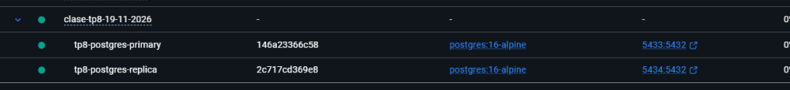
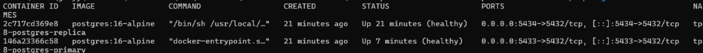
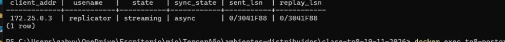
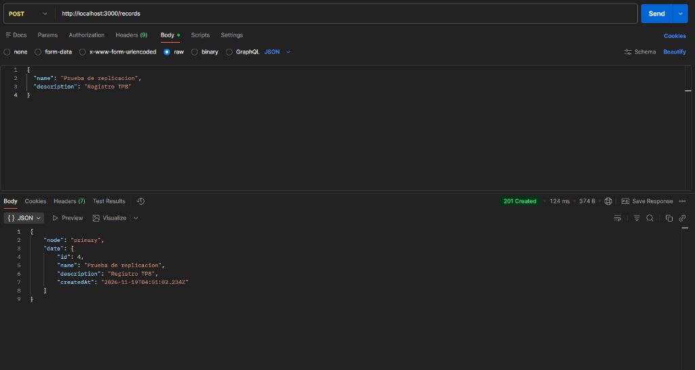
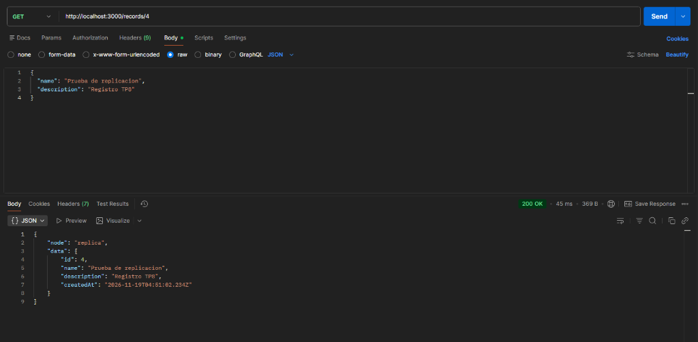
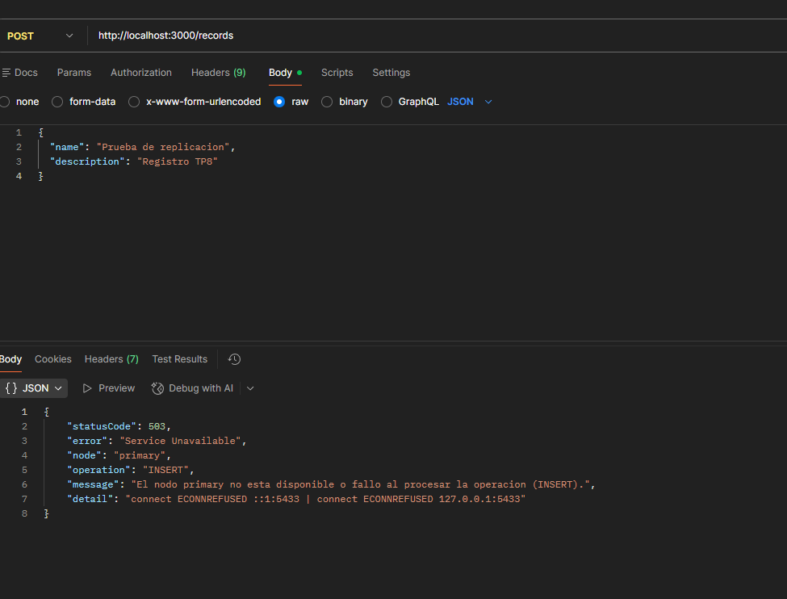
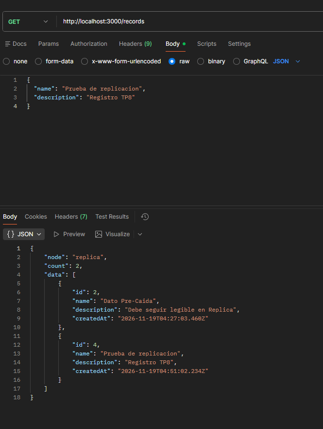

# TP8: Bases de Datos Distribuidas y Conexión entre Capas

Implementación de una arquitectura de base de datos distribuida **Primary / Replica** en PostgreSQL mediante **Streaming Replication**, conectada a un backend REST desarrollado con **NestJS** y **TypeORM** utilizando conexiones independientes para lectura y escritura.

---

## 1. Descripción del proyecto

Este trabajo práctico demuestra cómo separar explícitamente las operaciones de escritura (`INSERT`, `UPDATE`, `DELETE`) y lectura (`SELECT`) sobre dos instancias independientes de PostgreSQL en Docker, evaluando la propagación de datos vía WAL (*Write-Ahead Log*), la consistencia eventual en replicación asincrónica y el comportamiento del backend ante la caída del nodo Primary.

---

## 2. Objetivos

- Configurar una topología **Primary / Replica** en PostgreSQL con replicación física (*streaming replication*).
- Conectar un backend **NestJS + TypeORM** a ambos nodos mediante dos `DataSource` independientes (`primary` y `replica`).
- Enrutar explícitamente escrituras al Primary y lecturas a la Replica, sin redirección silenciosa de escrituras en caso de fallo.
- Validar la propagación de datos, consistencia y respuesta HTTP ante indisponibilidad del nodo Primary.

---

## 3. Tecnologías utilizadas

- **Node.js** `v24.15.0`
- **TypeScript** `^5.7.0`
- **NestJS** `^11.0.0` (`@nestjs/common`, `@nestjs/core`, `@nestjs/config`, `@nestjs/platform-express`)
- **TypeORM** `^1.1.3` (`@nestjs/typeorm`, `pg`)
- **PostgreSQL** `16-alpine`
- **Docker** y **Docker Compose**
- **pnpm** `10.28.2`

---

## 4. Arquitectura distribuida

La arquitectura sigue el modelo de **Replicación de Copia Primaria (Pasiva)** en un entorno *Shared-Nothing* entre contenedores:

- **Nodo Primary (`tp8-postgres-primary`):** único punto de entrada para modificaciones de estado (`INSERT`, `UPDATE`, `DELETE`).
- **Nodo Replica (`tp8-postgres-replica`):** configurado en modo `hot_standby` (solo lectura). Recibe los registros WAL desde el Primary mediante un slot físico (`replica_slot`) y atiende las consultas `SELECT`.
- **Backend NestJS (`backend/`):** mantiene dos pools de conexión independientes (`primary` y `replica`) y expone la API REST en el puerto `3000`.

---

## 5. Diagrama de arquitectura

```text
                       ┌─────────────────────────────┐
                       │      Cliente / HTTP API     │
                       └──────────────┬──────────────┘
                                      │
                                      ▼
                       ┌─────────────────────────────┐
                       │       Backend NestJS        │
                       │     (http://localhost:3000) │
                       └──┬───────────────────────┬──┘
                          │                       │
      POST / PATCH / DELETE                       GET /records, GET /records/:id
        (DataSource: primary)                       (DataSource: replica)
                          │                       │
                          ▼                       ▼
               ┌─────────────────────┐  WAL   ┌─────────────────────┐
               │ PostgreSQL Primary  │───────►│ PostgreSQL Replica  │
               │ Host: 5433 -> 5432  │Stream  │ Host: 5434 -> 5432  │
               │   (Lectura/Escrit.) │        │  (Solo Lectura /    │
               └─────────────────────┘        │    hot_standby)     │
                                              └─────────────────────┘
```

---

## 6. Funcionamiento de Primary / Replica

1. Al iniciar por primera vez, `tp8-postgres-primary` ejecuta `01-init-primary.sh` para crear el rol `replicator`, el slot físico `replica_slot` y habilitar la autenticación `scram-sha-256` en `pg_hba.conf`, seguido de `02-init-schema.sql` para crear la tabla `records`.
2. `tp8-postgres-replica` espera a que el Primary esté saludable (`service_healthy`), ejecuta `pg_basebackup` con `-R` (generando `standby.signal` y `primary_conninfo`) y arranca con `hot_standby=on`.
3. La replicación es **asincrónica** (`sync_state = async`): el Primary confirma la transacción localmente y transmite el flujo WAL a la Replica en segundo plano. Si se intenta ejecutar un `INSERT` directo en la Replica, PostgreSQL lo rechaza con `ERROR: cannot execute INSERT in a read-only transaction`.

---

## 7. Configuración de Docker Compose

Archivo: [docker-compose.yml](docker-compose.yml)

- **Puertos externos:** `5433` para Primary y `5434` para Replica (evita conflictos con el puerto `5432` local).
- **Volúmenes persistentes:** `tp8_postgres_primary_data` y `tp8_postgres_replica_data`.
- **Parámetros WAL en Primary:**
  - `wal_level=replica`
  - `max_wal_senders=10`
  - `max_replication_slots=10`
  - `wal_keep_size=64MB`
  - `hot_standby=on`
- **Healthchecks:** `pg_isready` cada 5 segundos en ambos contenedores.

---

## 8. Configuración de NestJS y TypeORM

- Variables de entorno definidas en [backend/.env.example](backend/.env.example) (sin credenciales en el código fuente).
- En [backend/src/database/database.module.ts](backend/src/database/database.module.ts) se registran dos conexiones `TypeOrmModule.forRootAsync`:
  - `name: 'primary'` apuntando a `DB_PRIMARY_HOST:DB_PRIMARY_PORT` (`localhost:5433`).
  - `name: 'replica'` apuntando a `DB_REPLICA_HOST:DB_REPLICA_PORT` (`localhost:5434`).
- Ambas conexiones tienen `synchronize: false` y `connectionTimeoutMillis: 3000` para detectar fallos de red rápidamente.

---

## 9. Distribución de operaciones de lectura y escritura

Implementada en [backend/src/records/records.service.ts](backend/src/records/records.service.ts):

| Operación | Método / Endpoint | DataSource TypeORM | Nodo destino |
| :--- | :--- | :--- | :--- |
| Consultar todos | `GET /records` | `replicaRepo` (`replica`) | PostgreSQL Replica |
| Consultar por ID | `GET /records/:id` | `replicaRepo` (`replica`) | PostgreSQL Replica |
| Crear registro | `POST /records` | `primaryRepo` (`primary`) | PostgreSQL Primary |
| Actualizar registro | `PATCH /records/:id` | `primaryRepo` (`primary`) | PostgreSQL Primary |
| Eliminar registro | `DELETE /records/:id` | `primaryRepo` (`primary`) | PostgreSQL Primary |
| Estado de nodos | `GET /health` | `primary` + `replica` | Ambos nodos |

Ante un error de conexión en cualquier nodo, el servicio registra el detalle con `Logger.error` y lanza `503 Service Unavailable` indicando el nodo y la operación afectada, **sin redirigir escrituras a la Replica**.

---

## 10. Endpoints y ejemplos de uso

- **Verificar salud de conexiones:**
  ```bash
  curl http://localhost:3000/health
  ```
- **Crear registro (Primary):**
  ```bash
  curl -X POST http://localhost:3000/records \
    -H "Content-Type: application/json" \
    -d '{"name":"Registro TP8","description":"Insertado en Primary"}'
  ```
- **Listar registros (Replica):**
  ```bash
  curl http://localhost:3000/records
  ```
- **Obtener un registro (Replica):**
  ```bash
  curl http://localhost:3000/records/1
  ```
- **Actualizar registro (Primary):**
  ```bash
  curl -X PATCH http://localhost:3000/records/1 \
    -H "Content-Type: application/json" \
    -d '{"description":"Actualizado desde Primary"}'
  ```
- **Eliminar registro (Primary):**
  ```bash
  curl -X DELETE http://localhost:3000/records/1
  ```

---

## 11. Procedimiento para ejecutar el proyecto

### 1. Configurar variables de entorno
```powershell
Copy-Item .env.example .env
Copy-Item backend\.env.example backend\.env
```

### 2. Levantar los nodos PostgreSQL
```powershell
docker-compose up -d
```

### 3. Verificar estado y replicación
```powershell
docker ps --filter "name=tp8-postgres"
docker exec tp8-postgres-primary psql -U postgres -d tp8_db -c "SELECT client_addr, usename, state, sync_state, sent_lsn, replay_lsn FROM pg_stat_replication;"
docker exec tp8-postgres-replica psql -U postgres -d tp8_db -c "SELECT pg_is_in_recovery() AS is_replica;"
```

### 4. Instalar dependencias, compilar y ejecutar el backend
```powershell
pnpm --dir backend install
pnpm --dir backend run build
pnpm --dir backend run start
```

### 5. Detener los contenedores
```powershell
docker-compose down
```
*(Para reiniciar desde cero eliminando volúmenes: `docker-compose down -v`)*

---

## 12. Pruebas realizadas y resultados

Todas las pruebas fueron ejecutadas contra los contenedores y el backend en funcionamiento:

- **Prueba 1 (Escritura en Primary):** `POST /records` creó el registro `id: 1` con `"node": "primary"`. La consulta SQL directa en `tp8-postgres-primary` confirmó la fila almacenada.
- **Prueba 2 (Lectura desde Replica vía backend):** `GET /records` y `GET /records/1` respondieron con `"node": "replica"` devolviendo el registro `id: 1`.
- **Prueba 3 (Verificación directa en Replica):** `SELECT id, name, description FROM records;` en `tp8-postgres-replica` devolvió inmediatamente el registro insertado en Primary. La propagación asincrónica en red local mostró convergencia inmediata (`sent_lsn == replay_lsn`).
- **Prueba 4 (Actualización y eliminación):** `PATCH /records/1` actualizó la descripción en Primary y se reflejó en Replica. `DELETE /records/1` eliminó el registro en Primary y ambos nodos quedaron con `0` filas.

---

## 13. Simulación de caída del Primary

Se insertó un registro previo (`id: 2`) y se detuvo el contenedor Primary (`docker stop tp8-postgres-primary`):

- `GET /health` reportó `"status": "degraded"`, con `primary.status = "down"` y `replica.status = "up"` (`inRecovery: true`).
- `POST /records` registró el fallo en `RecordsService` y respondió **`HTTP 503 Service Unavailable`** (no redirigió la escritura a la Replica).
- `GET /records` continuó operando sobre la Replica devolviendo el registro `id: 2`.
- Al reiniciar el contenedor (`docker start tp8-postgres-primary`), `GET /health` volvió a `"status": "ok"`.

**Limitaciones de la arquitectura:**
- No se implementa *failover* automático ni promoción de la Replica a Primary: mientras el Primary está caído, el sistema pierde disponibilidad de escritura pero conserva disponibilidad de lectura.
- Al utilizar replicación asincrónica, una caída abrupta del Primary antes de enviar el último WAL podría generar pérdida de las transacciones más recientes no replicadas.

---

## 14. Conclusiones

La separación explícita de conexiones en NestJS/TypeORM (`primary` y `replica`) junto con PostgreSQL Streaming Replication permite escalar lecturas manteniendo un único punto de verdad para escrituras. La prueba de caída confirmó que el backend detecta la indisponibilidad del Primary devolviendo errores controlados (`503`) mientras la Replica sigue atendiendo consultas de lectura de forma aislada.

---

## 15. Evidencias

### 1. Nodos PostgreSQL funcionando y conectados mediante replicación







### 2. Escritura exitosa en Primary y lectura posterior desde Replica





### 3. Simulación de caída del Primary y respuesta del backend





