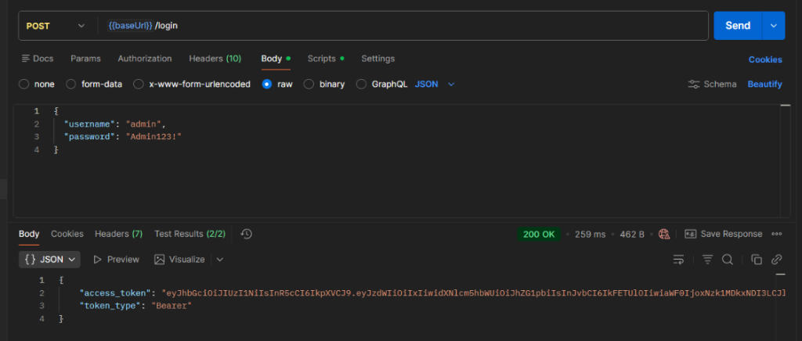
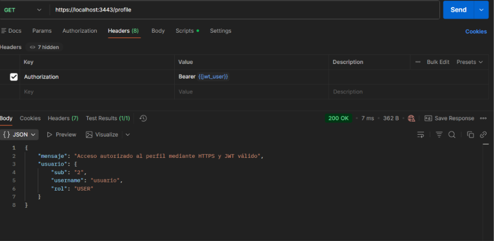
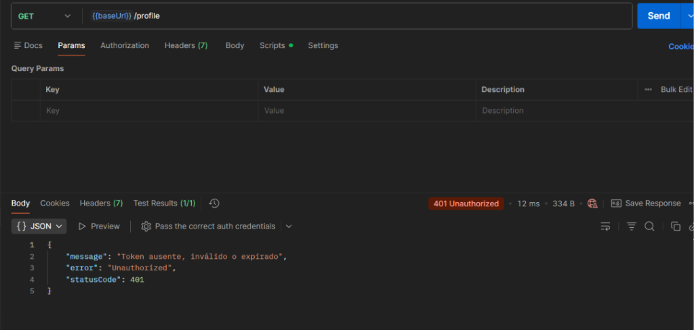
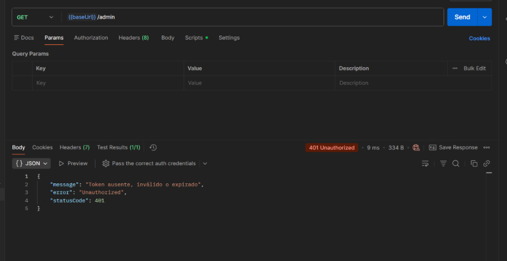
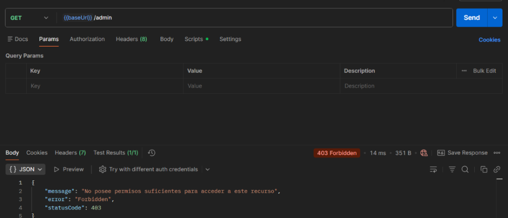
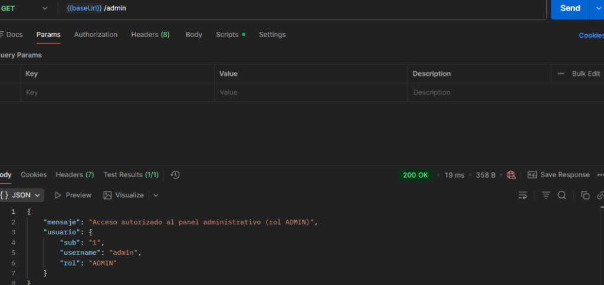

# Trabajo Práctico N.º 9 — Seguridad en Aplicaciones Distribuidas (JWT y TLS/SSL)

## 1. Carátula e Identificación

- **Trabajo Práctico**: N.º 9 — Seguridad en Aplicaciones Distribuidas (JWT y TLS/SSL)
- **Unidad Temática**: Unidad 4 — Seguridad en Aplicaciones Distribuidas
- **Ubicación en el repositorio**: `/clase-tp9-22-09-2026`

> **Observación documental**: La consigna oficial menciona la carpeta `/TP8` en la raíz del repositorio. Dado que el Trabajo Práctico N.º 8 ya se encuentra alojado en `clase-tp8-19-11-2026/`, este trabajo se ubica en `/clase-tp9-22-09-2026` (siguiendo la convención de nombres del repositorio) para evitar conflictos y mantener intactos los trabajos prácticos anteriores.

---

## 2. Estudiante

- **Nombre y Apellido**: Gabriela Tamara Sosa

---

## 3. Asignatura

- **Asignatura**: Desarrollo de Aplicaciones para Ambientes Distribuidos

---

## 4. Objetivo General

Diseñar, implementar y verificar una capa de seguridad *end-to-end* en una aplicación distribuida basada en NestJS y TypeScript, integrando cifrado en tránsito mediante **HTTPS/TLS**, autenticación sin estado (*stateless*) mediante **JSON Web Tokens (JWT)**, autorización basada en roles (*RBAC*) mediante Guards y detección criptográfica de alteración del payload (*Tampering*).

---

## 5. Tecnologías Utilizadas

- **Runtime**: Node.js (`v24.15.0`)
- **Framework**: NestJS (`^11.0.0`) + TypeScript (`^5.7.0`)
- **Autenticación y JWT**: `@nestjs/jwt`, `@nestjs/passport`, `passport`, `passport-jwt`
- **Hashing de contraseñas**: `bcrypt`
- **Validación de DTOs**: `class-validator`, `class-transformer`
- **Configuración**: `@nestjs/config`
- **Certificados TLS locales**: OpenSSL
- **Pruebas funcionales**: Postman + script de verificación Node.js (`clase-tp9-22-09-2026/cliente/tampering-test.mjs`)
- **Gestor de paquetes**: `pnpm`

---

## 6. Arquitectura de Seguridad

La solución separa claramente las responsabilidades en capas:

1. **Capa de Transporte (HTTPS/TLS)**: Todo el tráfico entre cliente y servidor viaja cifrado sobre TLS en el puerto `3443`. No se expone ningún endpoint HTTP alternativo.
2. **Capa de Autenticación (`AuthModule` + `UsersModule`)**: Verifica credenciales contra hashes `bcrypt` almacenados en memoria y emite un JWT firmado con `HMAC-SHA256` (`HS256`, algoritmo por defecto de `@nestjs/jwt` y `passport-jwt`).
3. **Capa de Validación de Identidad (`JwtStrategy` + `JwtAuthGuard`)**: Extrae el token del encabezado `Authorization: Bearer <token>`, verifica la firma criptográfica, la expiración (`exp`) y la presencia de los claims obligatorios (`sub`, `rol`, `exp`).
4. **Capa de Autorización (`RolesGuard` + `@Roles()`)**: Evalúa el rol del usuario autenticado (`ADMIN` o `USER`) antes de ejecutar el controlador destino.

---

## 7. Configuración HTTPS / TLS

El servidor NestJS se inicializa en `clase-tp9-22-09-2026/servidor/src/main.ts` cargando la clave privada y el certificado X.509 desde las rutas configuradas en las variables de entorno `TLS_KEY_PATH` y `TLS_CERT_PATH`, y pasando `httpsOptions` a `NestFactory.create(AppModule, { httpsOptions })`.

- **URL única de escucha**: `https://localhost:3443`
- **Seguridad en repositorio**: Tanto `.env` como `certs/*.key`, `certs/*.pem` y `certs/*.crt` están excluidos en `.gitignore` para no exponer secretos ni claves privadas.

---

## 8. Explicación de Certificados Digitales

Un certificado digital X.509 vincula una clave pública con una identidad (en este caso `CN=localhost` con `subjectAltName=DNS:localhost,IP:127.0.0.1`) y permite establecer el *handshake* TLS para negociar claves de sesión simétricas y cifrar el canal.

- **Limitación del certificado autofirmado**: Para desarrollo local se utiliza un certificado autofirmado generado con OpenSSL. Al no estar emitido por una Autoridad Certificante (CA) reconocida por el sistema operativo, navegadores y clientes como Postman muestran una advertencia de confianza. En producción debe utilizarse un certificado emitido por una CA confiable (por ejemplo, Let's Encrypt).

---

## 9. Autenticación JWT

El endpoint `POST /login` recibe `username` y `password`, valida el formato mediante `LoginDto`, busca el usuario en `UsersService` y compara la contraseña recibida con el hash `bcrypt` mediante `bcrypt.compare`.

> **Decisión de alcance académico**: Se utiliza un conjunto reducido de usuarios de demostración en memoria (`admin` con rol `ADMIN` y `usuario` con rol `USER`), cuyas contraseñas se almacenan exclusivamente como hashes `bcrypt` (nunca en texto plano).

Si las credenciales son inválidas, el servidor responde `HTTP 401 Unauthorized`. Si son válidas, emite un JWT firmado con el secreto `JWT_SECRET`.

---

## 10. Estructura del Token: Header, Payload y Signature

Un JWT se compone de tres segmentos codificados en **Base64URL** separados por puntos (`Header.Payload.Signature`):

1. **Header**: Indica el tipo de token (`JWT`) y el algoritmo de firma (`HS256`).
2. **Payload**: Contiene los *claims* (datos de identidad, rol y metadatos de expiración). No está cifrado, sino codificado en Base64URL, por lo que cualquier modificación altera su representación.
3. **Signature**: Firma criptográfica calculada sobre `Base64URL(Header) + "." + Base64URL(Payload)` utilizando `JWT_SECRET`. Garantiza la integridad y autenticidad del token.

---

## 11. Claims Utilizados: `sub`, `rol` y `exp`

- **`sub`**: Identificador único del usuario autenticado (`"1"` para `admin`, `"2"` para `usuario`).
- **`rol`**: Rol asignado al usuario (`"ADMIN"` o `"USER"`), utilizado por `RolesGuard` para autorización.
- **`exp`**: Marca de tiempo Unix (*timestamp*) de expiración del token (configurada mediante `JWT_EXPIRES_IN=15m`).

---

## 12. Autorización y Guards

- **`JwtAuthGuard` (`AuthGuard('jwt')`)**: Protege rutas autenticadas. Si falta el encabezado `Authorization: Bearer <token>`, el token está malformado, la firma no coincide o expiró, responde **`HTTP 401 Unauthorized`**.
- **`RolesGuard` + `@Roles(...)`**: Se ejecuta después de `JwtAuthGuard`. Si el usuario está autenticado pero su `rol` no cumple con los roles requeridos por el endpoint, responde **`HTTP 403 Forbidden`**.

---

## 13. Descripción de Endpoints

| Método | Ruta | Acceso | Descripción |
| :--- | :--- | :--- | :--- |
| `POST` | `/login` | Público | Valida credenciales con `bcrypt` y devuelve `access_token` JWT (`HTTP 200`). |
| `GET` | `/profile` | Autenticado (`ADMIN` / `USER`) | Requiere JWT válido y devuelve los datos básicos del usuario (`HTTP 200`). |
| `GET` | `/admin` | Solo `ADMIN` | Requiere JWT válido y rol `ADMIN` (`HTTP 200`; `403` si es `USER`). |

---

## 14. Instrucciones de Instalación

```powershell
cd clase-tp9-22-09-2026/servidor
pnpm install
```

Copiar `.env.example` a `.env` y configurar `JWT_SECRET` si se desea personalizar:

```powershell
Copy-Item .env.example .env
```

---

## 15. Generación de Certificados

Ejecutar el script de generación con OpenSSL:

```powershell
cd clase-tp9-22-09-2026/certificados
.\generar-certificados.ps1
```

Esto genera `clase-tp9-22-09-2026/servidor/certs/server.key` y `clase-tp9-22-09-2026/servidor/certs/server.crt` válidos por 365 días para `localhost` y `127.0.0.1` (no versionados en Git por estar excluidos en `.gitignore`).

Alternativamente, de forma manual con OpenSSL (Linux/macOS/Git Bash):

```bash
openssl req -x509 -newkey rsa:2048 -nodes \
  -keyout ../servidor/certs/server.key \
  -out ../servidor/certs/server.crt \
  -days 365 \
  -subj "/C=AR/ST=Cordoba/L=Cordoba/O=AmbientesDistribuidos/OU=TP9/CN=localhost" \
  -addext "subjectAltName=DNS:localhost,IP:127.0.0.1"
```

---

## 16. Instrucciones de Ejecución

Compilar y levantar el servidor HTTPS desde `clase-tp9-22-09-2026/servidor`:

```powershell
pnpm run build
pnpm run start:prod
```

El servidor quedará escuchando exclusivamente en `https://localhost:3443`.

Para ejecutar las pruebas automatizadas por consola (con el servidor encendido):

```powershell
node clase-tp9-22-09-2026/cliente/tampering-test.mjs
```

Para ejecutar las pruebas con **Postman**:

1. Importar `clase-tp9-22-09-2026/cliente/postman/TP9-Seguridad-JWT-TLS.postman_collection.json`.
2. Configurar SSL para el certificado autofirmado local: importar `clase-tp9-22-09-2026/servidor/certs/server.crt` en **Settings -> Certificates -> CA Certificates**, o desactivar temporalmente **SSL certificate verification** en **Settings -> General**.
3. Ejecutar las peticiones en orden (`1` a `7`). La petición `7` incluye un *Pre-request Script* que altera el payload del JWT de `USER` a `ADMIN` manteniendo la firma original para verificar la detección de *Tampering*.

---

## 17. Pruebas Realizadas

Se ejecutaron las pruebas funcionales obligatorias mediante `clase-tp9-22-09-2026/cliente/tampering-test.mjs` y verificaciones adicionales contra `https://localhost:3443`, y se dejó preparada la colección Postman en `clase-tp9-22-09-2026/cliente/postman/TP9-Seguridad-JWT-TLS.postman_collection.json`:

1. **Emisión de JWT (`POST /login`)** con `admin` (`Admin123!`), `usuario` (`Usuario123!`) y rechazo con credenciales incorrectas (`401`).
2. **Acceso autorizado mediante HTTPS (`GET /profile`)** con `Authorization: Bearer <token>`.
3. **Rechazo por falta de token, token inválido o token expirado (`GET /profile`)**.
4. **Autorización por roles (`GET /admin`)** con usuario `USER` (`403`) y con usuario `ADMIN` (`200`).
5. **Detección de Tampering**: Alteración manual del payload de `USER` a `ADMIN` manteniendo la firma original (`401`).
6. **Rechazo de HTTP plano**: Petición sin TLS a `http://localhost:3443/profile` rechazada (`ECONNRESET`).

---

## 18. Resultados y Códigos HTTP

| Caso de Prueba | Endpoint | Resultado Obtenido |
| :--- | :--- | :--- |
| Login con credenciales válidas (`admin` / `usuario`) | `POST /login` | `HTTP 200 OK` |
| Login con credenciales incorrectas | `POST /login` | `HTTP 401 Unauthorized` |
| Acceso autenticado con JWT válido | `GET /profile` | `HTTP 200 OK` |
| Acceso sin encabezado `Authorization` | `GET /profile` | `HTTP 401 Unauthorized` |
| Acceso con token malformado / inválido | `GET /profile` | `HTTP 401 Unauthorized` |
| Acceso con token expirado (`exp` vencido) | `GET /profile` | `HTTP 401 Unauthorized` |
| Acceso a ruta `ADMIN` con rol `USER` | `GET /admin` | `HTTP 403 Forbidden` |
| Acceso a ruta `ADMIN` con rol `ADMIN` | `GET /admin` | `HTTP 200 OK` |
| Envío de token con payload alterado (*Tampering*) | `GET /admin` y `GET /profile` | `HTTP 401 Unauthorized` |

---

## 19. Ataque de Tampering y su Detección

El ataque simulado consiste en:

1. Obtener un JWT válido para el usuario `usuario` (`"rol": "USER"`).
2. Separar el token en sus tres partes (`Header.Payload.Signature`).
3. Decodificar el `Payload` desde Base64URL y modificar `"rol": "USER"` por `"rol": "ADMIN"`.
4. Volver a codificar el payload alterado en Base64URL y reensamblar el token conservando la `Signature` original.
5. Enviar el token alterado a `GET /admin` y `GET /profile`.

**Resultado**: El servidor recalcula el HMAC-SHA256 sobre el `Header` y el `Payload` alterado usando `JWT_SECRET`. Como la firma no coincide con la firma original adjunta, `Passport`/`JwtStrategy` rechaza inmediatamente la petición con **`HTTP 401 Unauthorized`**, demostrando que nunca se confía en los claims sin verificar la firma criptográfica.

---

## 20. Capturas de Evidencias Obligatorias

Capturas obtenidas con Postman en `clase-tp9-22-09-2026/evidencias/` (con el certificado `server.crt` importado en Postman o desactivando *SSL certificate verification* para pruebas locales):

1. **Captura 1 — Emisión de JWT (`POST /login`)**:
   

2. **Captura 2 — Acceso autorizado mediante HTTPS (`GET /profile`)**:
   > Debe mostrar en Postman la URL (`GET {{baseUrl}}/profile`), el encabezado `Authorization: Bearer <token>` y la respuesta `HTTP 200 OK`.
   

3. **Captura 3 — Rechazo por falta de token o token inválido (`HTTP 401`)**:
   

4. **Captura 4 — Detección de Tampering (`HTTP 401`)**:
   

5. *(Complementaria)* **Rechazo por rol insuficiente (`HTTP 403`)**:
   

6. *(Complementaria)* **Acceso autorizado con rol `ADMIN` (`HTTP 200`)**:
   

---

## 21. Conclusiones

- La combinación de **TLS/HTTPS** y **JWT** proporciona seguridad complementaria: TLS cifra el canal evitando la intercepción de credenciales y tokens en tránsito, mientras que JWT garantiza autenticación *stateless* e integridad de los claims mediante firma criptográfica.
- La separación entre **autenticación** (`401 Unauthorized` en `JwtAuthGuard`) y **autorización** (`403 Forbidden` en `RolesGuard`) permite un control de acceso claro, modular y extensible en NestJS.
- La prueba de *Tampering* confirma que alterar cualquier byte del payload invalida la firma HMAC-SHA256 e impide la escalada de privilegios.
